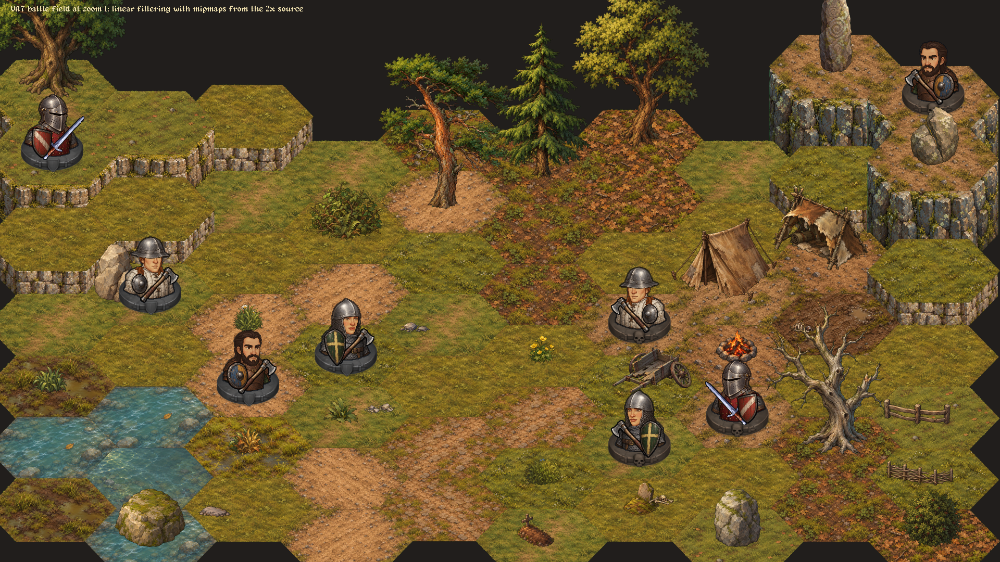
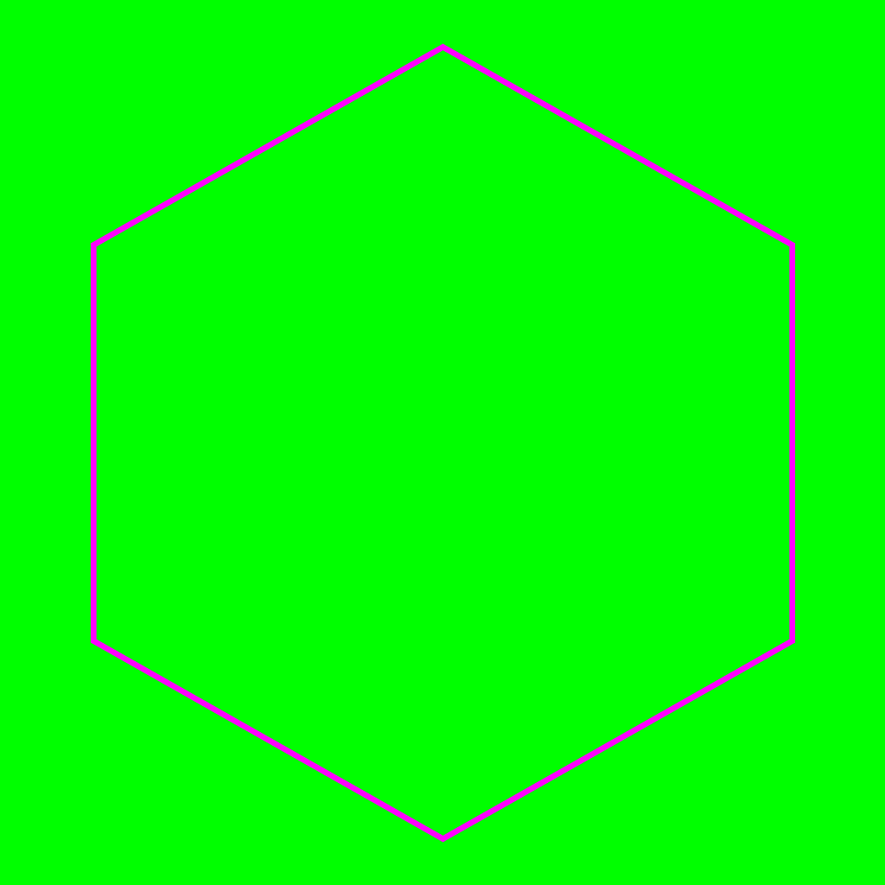
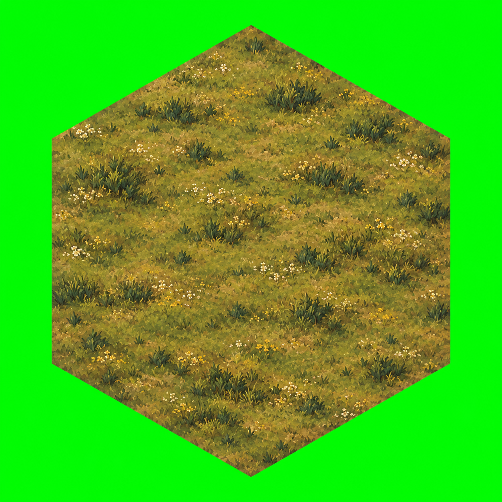

# Hex Art Techniques

How **Fantasy Warband** turns AI-painted hexes, trees and rocks into a coherent landscape.

The recipe is **template-guided painting → deterministic fitting and cleanup → layered sprites and soft joins**. This repository contains the actual terrain art, recorded generation prompts, normalization code and runtime shader sources used by the game, plus a small example you can reproduce without generating a new image.



## Start here

- [Walk through the technique](docs/technique.md): geometry, visual consistency, chroma keying, fitting, feathering and depth.
- [Browse all 111 assets and their prompts](docs/assets.md): 56 battlefield pieces and 55 overworld pieces.
- [Replay a real generation](#reproduce-one-shipped-tile): guide, raw image and final transparent tile.
- [Understand the shaders](docs/shaders.md): the overworld's noise-broken crossfade and sight effect.

## What is included

| Folder | Contents |
| --- | --- |
| `assets/terrain/` | Battlefield ground caps and limestone/granite cliff faces |
| `assets/environment/` | Trees, rocks, fences, tents, grass clumps and small dressing |
| `assets/worldmap/` | Overworld ground, roads, rivers, forests, hills and peaks |
| `prompts/` | Exact recorded prompt text and selected provenance for each shipped PNG |
| `references/` | Cropped original style references used to keep each family consistent |
| `examples/meadow_02/` | An original raw generation, its guide and its supplied style reference |
| `tools/art/` | Original Lua pipeline, image processing and normalization implementation |
| `data/items/visual_templates.lua` | The five terrain families' shared scale and placement contracts |
| `shaders/` | Original LÖVE fragment shaders extracted as readable GLSL files |
| `reference/` | Original game renderer modules for studying integration and draw order |
| `previews/` | Native LÖVE captures showing the art in context |

The `reference/` modules depend on the full game's runtime and are provided for study. The normalization commands below run independently. Some generalized branches in the original art tools serve other art families; only the five terrain families and two curated batches are exposed here. Character and settlement sprites visible in the contextual screenshots are not part of the exported sprite set.

## Reproduce one shipped tile

Install **Lua 5.4** and **ImageMagick 7** (`lua` and `magick` on your PATH). The tools also invoke a POSIX shell, `mkdir`, `cp`, and `shasum`; the replay works on macOS and on Linux with these utilities installed. Run from the repository root:

```sh
lua tools/art/pipeline.lua guide overworld meadow_02
cp examples/meadow_02/raw.png tmp/art/overworld/meadow_02/gen_1/raw.png
lua tools/art/pipeline.lua normalize overworld meadow_02
lua tools/art/pipeline.lua sheet overworld meadow_02
```

Start with a fresh clone or an empty `tmp/` directory: `guide` creates the next numbered attempt each time. The example above uses the first attempt. The raw image is retained unchanged; the guide command recreates its template and prepares the local style reference.

Results:

- `tmp/art/overworld/meadow_02/out/asset.png`: fitted, transparent, feathered terrain.
- `tmp/art/overworld/meadow_02/out/qa.lua`: measured placement, fill, halo checks and hashes.
- `tmp/art/overworld/contact_sheet.png`: the tile at source and display scales.

Compare the reproduced file with the shipped tile:

```sh
cmp tmp/art/overworld/meadow_02/out/asset.png assets/worldmap/tiles/meadow_02.png
```

A successful `cmp` prints nothing and exits zero. This example reproduced the shipped PNG byte for byte during preparation of this repository.

| Guide | Original generation | Shipped tile |
| --- | --- | --- |
|  |  |  |

## Paint a new piece

1. Choose or copy an item in `tools/art/batches/battlefield.lua` or `overworld.lua`. Set a new ID, subject and output path. Keep its family and size class appropriate to the piece.
2. Run `lua tools/art/pipeline.lua guide battlefield YOUR_ID`.
3. Supply the generated `template.png` and `style_ref_1.png` to an image generator in edit/reference mode, with that attempt's `prompt.txt`. Save the unmodified result as `raw.png` beside them.
4. Run `normalize` and `sheet` for that item. Inspect it beside existing ground and props at the intended display size; revise the generation if colour, light or perspective clash.
5. After the checks and visual review pass, copy the reviewed `out/asset.png` into your own asset library. The manual guide-and-save workflow does not create a generation record, so it cannot use `promote`. The optional `generate` automation records its session and raw image; those recorded runs can use `promote` to copy passing art into the batch's output path and write provenance.

The original tool also has a `generate` command that invokes a locally installed, authenticated Codex CLI with built-in image generation. That automation is optional and depends on your CLI version and account capabilities. No model call is needed for the included replay. The historical ledger identifies the generator as Codex built-in image generation; it does not identify the underlying image model. New generations will vary.

## Verify the package

```sh
python3 tools/verify.py
```

After staging the intended files with `git add`, this checks every exported asset's SHA-256, PNG metadata, prompt/provenance pairing, local Markdown links, and the tracked text for personal paths and credential patterns. In a fresh clone, all intended files are already tracked. It needs only Python's standard library.

The public repository starts with fresh history. No game journals, environment files, model-session logs, credentials or original Git history are included.

## Reuse

Code, shaders, documentation and prompt text are available under the [MIT License](LICENSE). Artwork, raw images, style references and screenshots have separate terms in [ARTWORK.md](ARTWORK.md).
