# Asset and prompt index

Each row links the shipped transparent PNG, its exact recorded generation prompt, and selected provenance. All images can be inspected at full size by following the image link.

## Battlefield

| Preview | Asset | Family | Prompt | Provenance |
| --- | --- | --- | --- | --- |
|  | [bones_01](../assets/environment/clutter/bones_01.png) | `prop` | [text](../prompts/battlefield/bones_01.txt) | [JSON](../prompts/battlefield/bones_01.json) |
|  | [bones_02](../assets/environment/clutter/bones_02.png) | `prop` | [text](../prompts/battlefield/bones_02.txt) | [JSON](../prompts/battlefield/bones_02.json) |
| 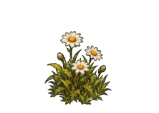 | [flowers_01](../assets/environment/clutter/flowers_01.png) | `prop` | [text](../prompts/battlefield/flowers_01.txt) | [JSON](../prompts/battlefield/flowers_01.json) |
| 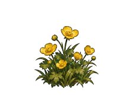 | [flowers_02](../assets/environment/clutter/flowers_02.png) | `prop` | [text](../prompts/battlefield/flowers_02.txt) | [JSON](../prompts/battlefield/flowers_02.json) |
| 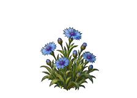 | [flowers_03](../assets/environment/clutter/flowers_03.png) | `prop` | [text](../prompts/battlefield/flowers_03.txt) | [JSON](../prompts/battlefield/flowers_03.json) |
| 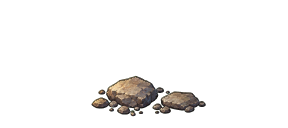 | [pebbles_01](../assets/environment/clutter/pebbles_01.png) | `prop` | [text](../prompts/battlefield/pebbles_01.txt) | [JSON](../prompts/battlefield/pebbles_01.json) |
| 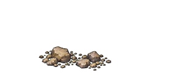 | [pebbles_02](../assets/environment/clutter/pebbles_02.png) | `prop` | [text](../prompts/battlefield/pebbles_02.txt) | [JSON](../prompts/battlefield/pebbles_02.json) |
| 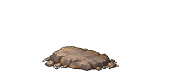 | [pebbles_03](../assets/environment/clutter/pebbles_03.png) | `prop` | [text](../prompts/battlefield/pebbles_03.txt) | [JSON](../prompts/battlefield/pebbles_03.json) |
| 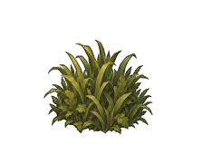 | [tuft_01](../assets/environment/clutter/tuft_01.png) | `prop` | [text](../prompts/battlefield/tuft_01.txt) | [JSON](../prompts/battlefield/tuft_01.json) |
| 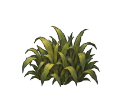 | [tuft_02](../assets/environment/clutter/tuft_02.png) | `prop` | [text](../prompts/battlefield/tuft_02.txt) | [JSON](../prompts/battlefield/tuft_02.json) |
| 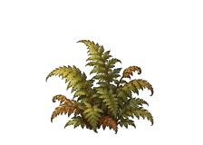 | [tuft_03](../assets/environment/clutter/tuft_03.png) | `prop` | [text](../prompts/battlefield/tuft_03.txt) | [JSON](../prompts/battlefield/tuft_03.json) |
| 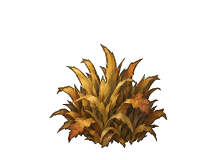 | [tuft_04](../assets/environment/clutter/tuft_04.png) | `prop` | [text](../prompts/battlefield/tuft_04.txt) | [JSON](../prompts/battlefield/tuft_04.json) |
| 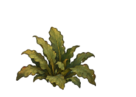 | [tuft_05](../assets/environment/clutter/tuft_05.png) | `prop` | [text](../prompts/battlefield/tuft_05.txt) | [JSON](../prompts/battlefield/tuft_05.json) |
| 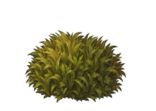 | [tuft_06](../assets/environment/clutter/tuft_06.png) | `prop` | [text](../prompts/battlefield/tuft_06.txt) | [JSON](../prompts/battlefield/tuft_06.json) |
| 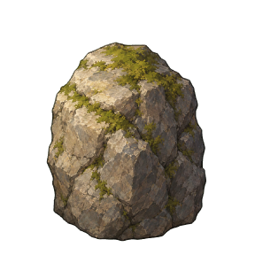 | [boulder_01](../assets/environment/props/boulder_01.png) | `prop` | [text](../prompts/battlefield/boulder_01.txt) | [JSON](../prompts/battlefield/boulder_01.json) |
| 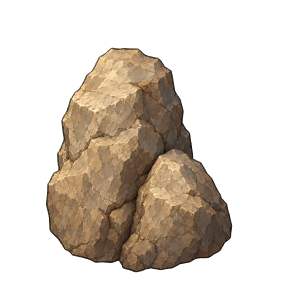 | [boulder_02](../assets/environment/props/boulder_02.png) | `prop` | [text](../prompts/battlefield/boulder_02.txt) | [JSON](../prompts/battlefield/boulder_02.json) |
| 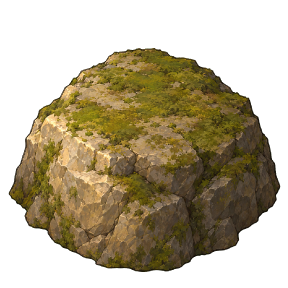 | [boulder_03](../assets/environment/props/boulder_03.png) | `prop` | [text](../prompts/battlefield/boulder_03.txt) | [JSON](../prompts/battlefield/boulder_03.json) |
| 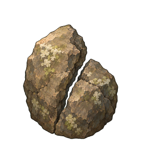 | [boulder_04](../assets/environment/props/boulder_04.png) | `prop` | [text](../prompts/battlefield/boulder_04.txt) | [JSON](../prompts/battlefield/boulder_04.json) |
| 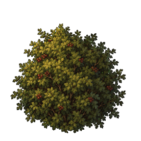 | [bush_01](../assets/environment/props/bush_01.png) | `prop` | [text](../prompts/battlefield/bush_01.txt) | [JSON](../prompts/battlefield/bush_01.json) |
| 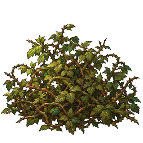 | [bush_02](../assets/environment/props/bush_02.png) | `prop` | [text](../prompts/battlefield/bush_02.txt) | [JSON](../prompts/battlefield/bush_02.json) |
| 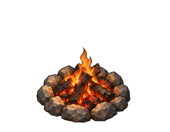 | [campfire](../assets/environment/props/campfire.png) | `prop` | [text](../prompts/battlefield/campfire.txt) | [JSON](../prompts/battlefield/campfire.json) |
| 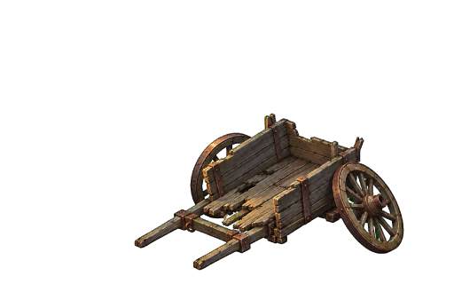 | [cart](../assets/environment/props/cart.png) | `prop` | [text](../prompts/battlefield/cart.txt) | [JSON](../prompts/battlefield/cart.json) |
| 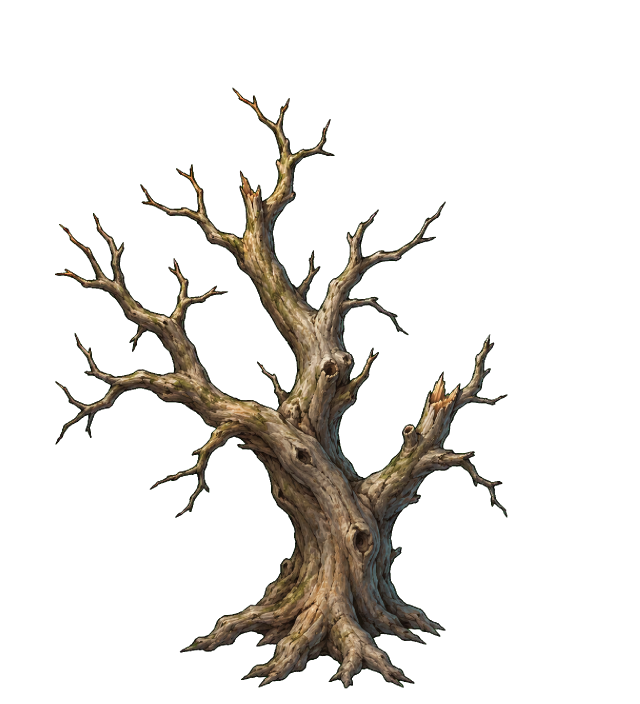 | [dead_tree](../assets/environment/props/dead_tree.png) | `prop` | [text](../prompts/battlefield/dead_tree.txt) | [JSON](../prompts/battlefield/dead_tree.json) |
| 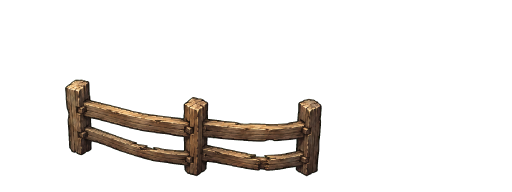 | [fence_01](../assets/environment/props/fence_01.png) | `prop` | [text](../prompts/battlefield/fence_01.txt) | [JSON](../prompts/battlefield/fence_01.json) |
| 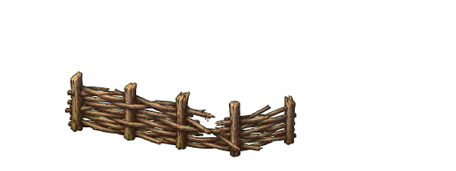 | [fence_02](../assets/environment/props/fence_02.png) | `prop` | [text](../prompts/battlefield/fence_02.txt) | [JSON](../prompts/battlefield/fence_02.json) |
| 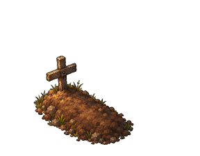 | [grave_01](../assets/environment/props/grave_01.png) | `prop` | [text](../prompts/battlefield/grave_01.txt) | [JSON](../prompts/battlefield/grave_01.json) |
| 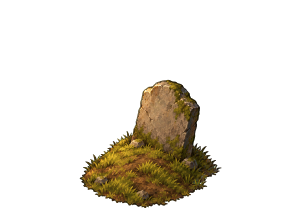 | [grave_02](../assets/environment/props/grave_02.png) | `prop` | [text](../prompts/battlefield/grave_02.txt) | [JSON](../prompts/battlefield/grave_02.json) |
| 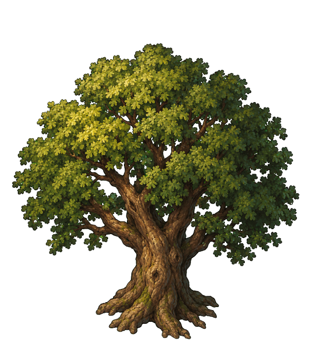 | [oak_01](../assets/environment/props/oak_01.png) | `prop` | [text](../prompts/battlefield/oak_01.txt) | [JSON](../prompts/battlefield/oak_01.json) |
| 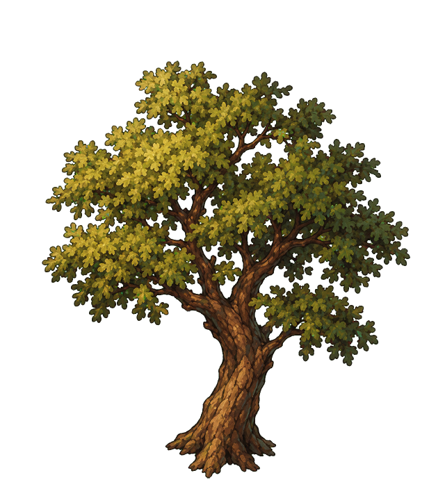 | [oak_02](../assets/environment/props/oak_02.png) | `prop` | [text](../prompts/battlefield/oak_02.txt) | [JSON](../prompts/battlefield/oak_02.json) |
| 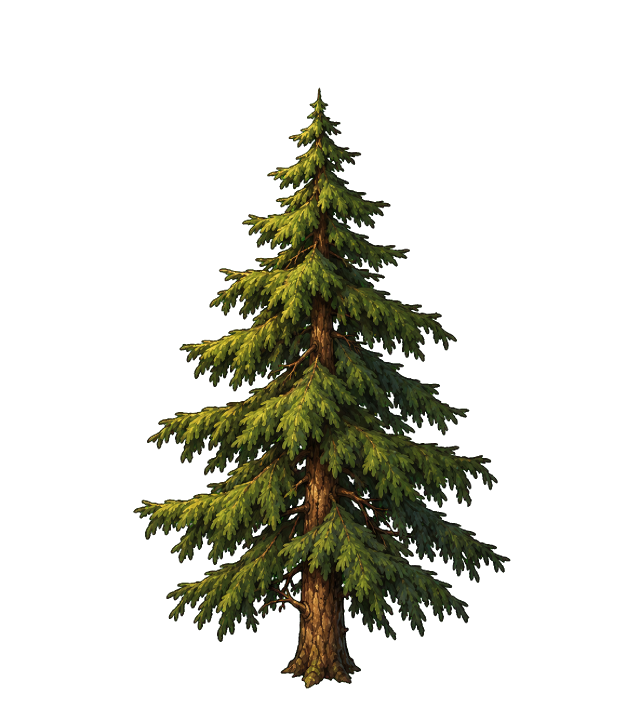 | [pine_01](../assets/environment/props/pine_01.png) | `prop` | [text](../prompts/battlefield/pine_01.txt) | [JSON](../prompts/battlefield/pine_01.json) |
| 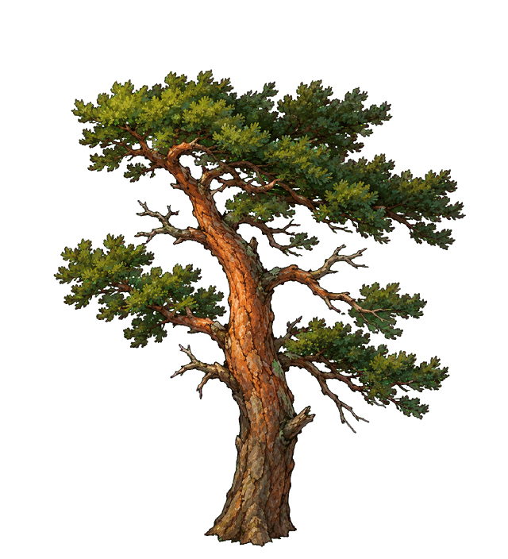 | [pine_02](../assets/environment/props/pine_02.png) | `prop` | [text](../prompts/battlefield/pine_02.txt) | [JSON](../prompts/battlefield/pine_02.json) |
| 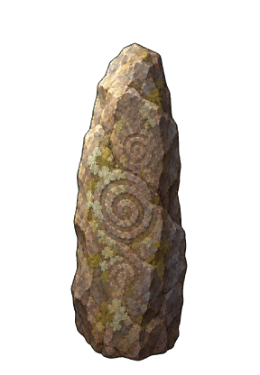 | [standing_stone](../assets/environment/props/standing_stone.png) | `prop` | [text](../prompts/battlefield/standing_stone.txt) | [JSON](../prompts/battlefield/standing_stone.json) |
| 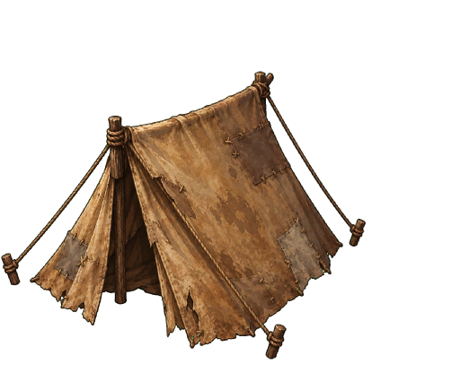 | [tent_01](../assets/environment/props/tent_01.png) | `prop` | [text](../prompts/battlefield/tent_01.txt) | [JSON](../prompts/battlefield/tent_01.json) |
| 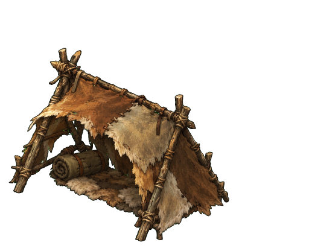 | [tent_02](../assets/environment/props/tent_02.png) | `prop` | [text](../prompts/battlefield/tent_02.txt) | [JSON](../prompts/battlefield/tent_02.json) |
| 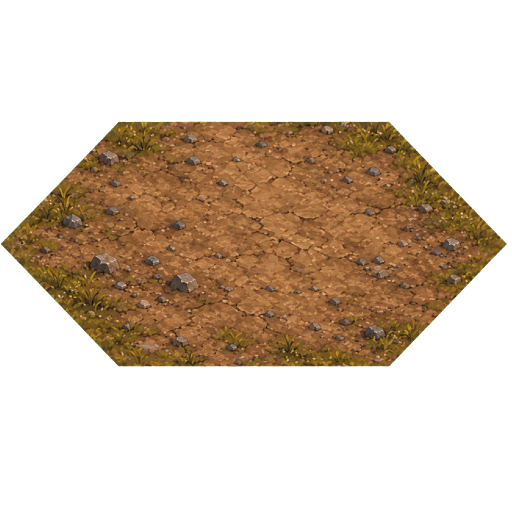 | [dirt_01](../assets/terrain/caps/dirt_01.png) | `hex_cap` | [text](../prompts/battlefield/dirt_01.txt) | [JSON](../prompts/battlefield/dirt_01.json) |
| 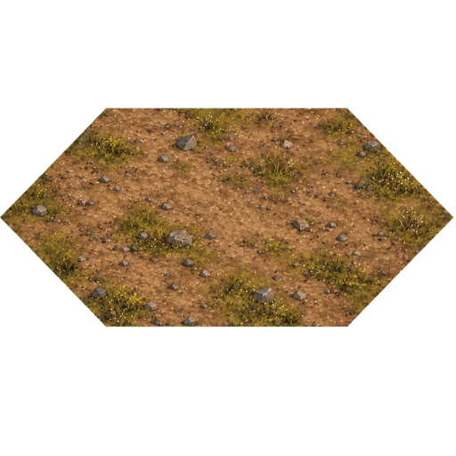 | [dirt_02](../assets/terrain/caps/dirt_02.png) | `hex_cap` | [text](../prompts/battlefield/dirt_02.txt) | [JSON](../prompts/battlefield/dirt_02.json) |
| 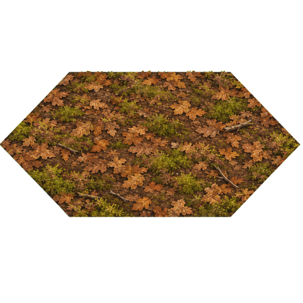 | [forest_floor_01](../assets/terrain/caps/forest_floor_01.png) | `hex_cap` | [text](../prompts/battlefield/forest_floor_01.txt) | [JSON](../prompts/battlefield/forest_floor_01.json) |
| 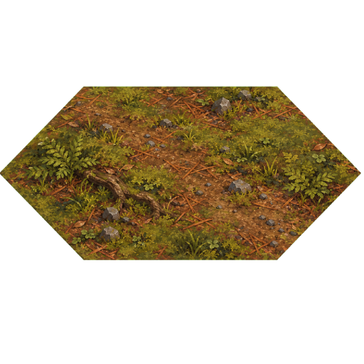 | [forest_floor_02](../assets/terrain/caps/forest_floor_02.png) | `hex_cap` | [text](../prompts/battlefield/forest_floor_02.txt) | [JSON](../prompts/battlefield/forest_floor_02.json) |
| 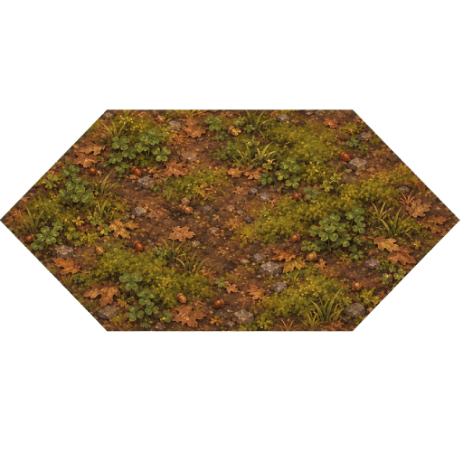 | [forest_floor_03](../assets/terrain/caps/forest_floor_03.png) | `hex_cap` | [text](../prompts/battlefield/forest_floor_03.txt) | [JSON](../prompts/battlefield/forest_floor_03.json) |
| 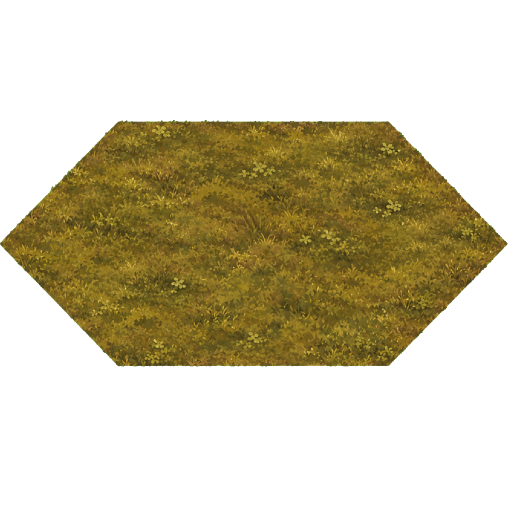 | [grass_01](../assets/terrain/caps/grass_01.png) | `hex_cap` | [text](../prompts/battlefield/grass_01.txt) | [JSON](../prompts/battlefield/grass_01.json) |
| 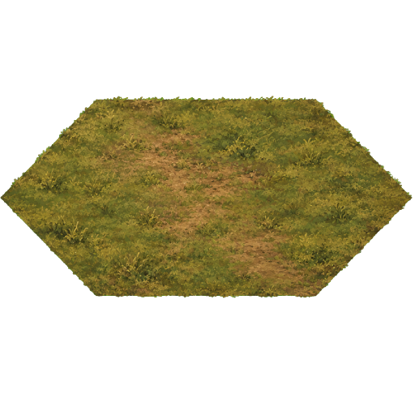 | [grass_02](../assets/terrain/caps/grass_02.png) | `hex_cap` | [text](../prompts/battlefield/grass_02.txt) | [JSON](../prompts/battlefield/grass_02.json) |
| 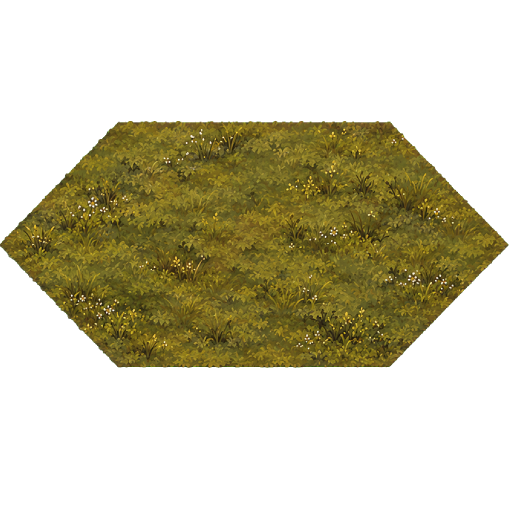 | [grass_03](../assets/terrain/caps/grass_03.png) | `hex_cap` | [text](../prompts/battlefield/grass_03.txt) | [JSON](../prompts/battlefield/grass_03.json) |
| 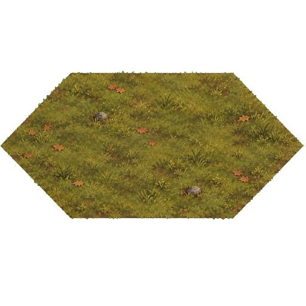 | [grass_04](../assets/terrain/caps/grass_04.png) | `hex_cap` | [text](../prompts/battlefield/grass_04.txt) | [JSON](../prompts/battlefield/grass_04.json) |
| 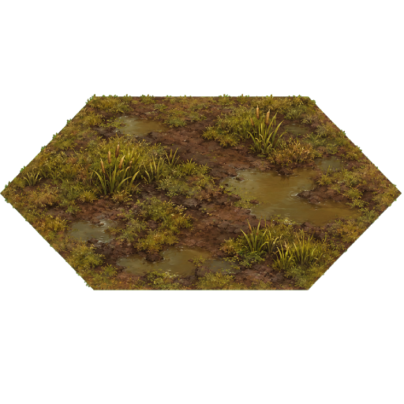 | [marsh_01](../assets/terrain/caps/marsh_01.png) | `hex_cap` | [text](../prompts/battlefield/marsh_01.txt) | [JSON](../prompts/battlefield/marsh_01.json) |
| 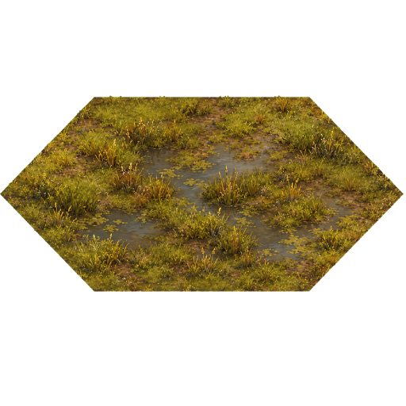 | [marsh_02](../assets/terrain/caps/marsh_02.png) | `hex_cap` | [text](../prompts/battlefield/marsh_02.txt) | [JSON](../prompts/battlefield/marsh_02.json) |
| 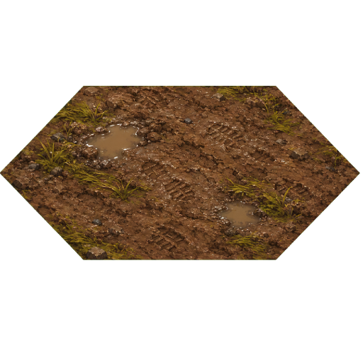 | [mud_01](../assets/terrain/caps/mud_01.png) | `hex_cap` | [text](../prompts/battlefield/mud_01.txt) | [JSON](../prompts/battlefield/mud_01.json) |
| 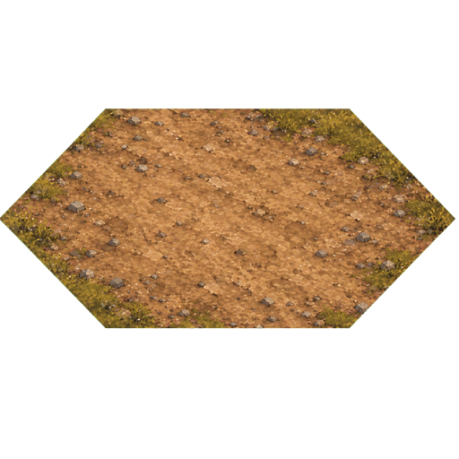 | [road_01](../assets/terrain/caps/road_01.png) | `hex_cap` | [text](../prompts/battlefield/road_01.txt) | [JSON](../prompts/battlefield/road_01.json) |
| 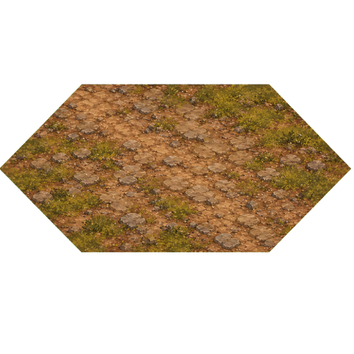 | [road_02](../assets/terrain/caps/road_02.png) | `hex_cap` | [text](../prompts/battlefield/road_02.txt) | [JSON](../prompts/battlefield/road_02.json) |
| 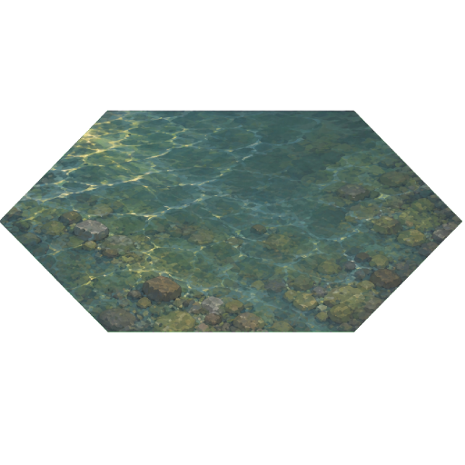 | [water_01](../assets/terrain/caps/water_01.png) | `hex_cap` | [text](../prompts/battlefield/water_01.txt) | [JSON](../prompts/battlefield/water_01.json) |
| 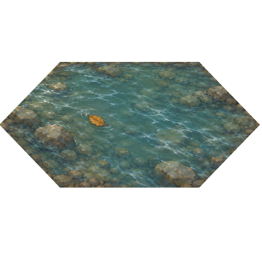 | [water_02](../assets/terrain/caps/water_02.png) | `hex_cap` | [text](../prompts/battlefield/water_02.txt) | [JSON](../prompts/battlefield/water_02.json) |
| 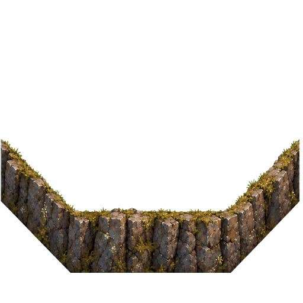 | [granite_1](../assets/terrain/cliffs/granite_1.png) | `cliff_band` | [text](../prompts/battlefield/granite_1.txt) | [JSON](../prompts/battlefield/granite_1.json) |
| 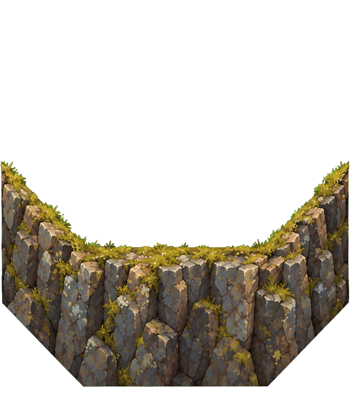 | [granite_2](../assets/terrain/cliffs/granite_2.png) | `cliff_band` | [text](../prompts/battlefield/granite_2.txt) | [JSON](../prompts/battlefield/granite_2.json) |
|  | [granite_3](../assets/terrain/cliffs/granite_3.png) | `cliff_band` | [text](../prompts/battlefield/granite_3.txt) | [JSON](../prompts/battlefield/granite_3.json) |
|  | [limestone_1](../assets/terrain/cliffs/limestone_1.png) | `cliff_band` | [text](../prompts/battlefield/limestone_1.txt) | [JSON](../prompts/battlefield/limestone_1.json) |
|  | [limestone_2](../assets/terrain/cliffs/limestone_2.png) | `cliff_band` | [text](../prompts/battlefield/limestone_2.txt) | [JSON](../prompts/battlefield/limestone_2.json) |
|  | [limestone_3](../assets/terrain/cliffs/limestone_3.png) | `cliff_band` | [text](../prompts/battlefield/limestone_3.txt) | [JSON](../prompts/battlefield/limestone_3.json) |

## Overworld

| Preview | Asset | Family | Prompt | Provenance |
| --- | --- | --- | --- | --- |
|  | [forest_01](../assets/worldmap/doodads/forest_01.png) | `doodad` | [text](../prompts/overworld/forest_01.txt) | [JSON](../prompts/overworld/forest_01.json) |
|  | [forest_02](../assets/worldmap/doodads/forest_02.png) | `doodad` | [text](../prompts/overworld/forest_02.txt) | [JSON](../prompts/overworld/forest_02.json) |
|  | [forest_03](../assets/worldmap/doodads/forest_03.png) | `doodad` | [text](../prompts/overworld/forest_03.txt) | [JSON](../prompts/overworld/forest_03.json) |
|  | [forest_04](../assets/worldmap/doodads/forest_04.png) | `doodad` | [text](../prompts/overworld/forest_04.txt) | [JSON](../prompts/overworld/forest_04.json) |
|  | [forest_05](../assets/worldmap/doodads/forest_05.png) | `doodad` | [text](../prompts/overworld/forest_05.txt) | [JSON](../prompts/overworld/forest_05.json) |
|  | [forest_06](../assets/worldmap/doodads/forest_06.png) | `doodad` | [text](../prompts/overworld/forest_06.txt) | [JSON](../prompts/overworld/forest_06.json) |
|  | [hill_01](../assets/worldmap/doodads/hill_01.png) | `doodad` | [text](../prompts/overworld/hill_01.txt) | [JSON](../prompts/overworld/hill_01.json) |
|  | [hill_02](../assets/worldmap/doodads/hill_02.png) | `doodad` | [text](../prompts/overworld/hill_02.txt) | [JSON](../prompts/overworld/hill_02.json) |
|  | [hill_03](../assets/worldmap/doodads/hill_03.png) | `doodad` | [text](../prompts/overworld/hill_03.txt) | [JSON](../prompts/overworld/hill_03.json) |
|  | [peak_01](../assets/worldmap/doodads/peak_01.png) | `doodad` | [text](../prompts/overworld/peak_01.txt) | [JSON](../prompts/overworld/peak_01.json) |
|  | [peak_02](../assets/worldmap/doodads/peak_02.png) | `doodad` | [text](../prompts/overworld/peak_02.txt) | [JSON](../prompts/overworld/peak_02.json) |
|  | [peak_03](../assets/worldmap/doodads/peak_03.png) | `doodad` | [text](../prompts/overworld/peak_03.txt) | [JSON](../prompts/overworld/peak_03.json) |
|  | [peak_04](../assets/worldmap/doodads/peak_04.png) | `doodad` | [text](../prompts/overworld/peak_04.txt) | [JSON](../prompts/overworld/peak_04.json) |
|  | [reeds_01](../assets/worldmap/doodads/reeds_01.png) | `doodad` | [text](../prompts/overworld/reeds_01.txt) | [JSON](../prompts/overworld/reeds_01.json) |
|  | [reeds_02](../assets/worldmap/doodads/reeds_02.png) | `doodad` | [text](../prompts/overworld/reeds_02.txt) | [JSON](../prompts/overworld/reeds_02.json) |
|  | [river_n](../assets/worldmap/rivers/river_n.png) | `world_tile` | [text](../prompts/overworld/river_n.txt) | [JSON](../prompts/overworld/river_n.json) |
|  | [river_ne](../assets/worldmap/rivers/river_ne.png) | `world_tile` | [text](../prompts/overworld/river_ne.txt) | [JSON](../prompts/overworld/river_ne.json) |
|  | [river_nw](../assets/worldmap/rivers/river_nw.png) | `world_tile` | [text](../prompts/overworld/river_nw.txt) | [JSON](../prompts/overworld/river_nw.json) |
|  | [river_s](../assets/worldmap/rivers/river_s.png) | `world_tile` | [text](../prompts/overworld/river_s.txt) | [JSON](../prompts/overworld/river_s.json) |
|  | [river_se](../assets/worldmap/rivers/river_se.png) | `world_tile` | [text](../prompts/overworld/river_se.txt) | [JSON](../prompts/overworld/river_se.json) |
|  | [river_sw](../assets/worldmap/rivers/river_sw.png) | `world_tile` | [text](../prompts/overworld/river_sw.txt) | [JSON](../prompts/overworld/river_sw.json) |
|  | [bridge_stone_se](../assets/worldmap/roads/bridge_stone_se.png) | `world_tile` | [text](../prompts/overworld/bridge_stone_se.txt) | [JSON](../prompts/overworld/bridge_stone_se.json) |
|  | [bridge_wood_se](../assets/worldmap/roads/bridge_wood_se.png) | `world_tile` | [text](../prompts/overworld/bridge_wood_se.txt) | [JSON](../prompts/overworld/bridge_wood_se.json) |
|  | [dirt_hub](../assets/worldmap/roads/dirt_hub.png) | `world_tile` | [text](../prompts/overworld/dirt_hub.txt) | [JSON](../prompts/overworld/dirt_hub.json) |
|  | [dirt_n](../assets/worldmap/roads/dirt_n.png) | `world_tile` | [text](../prompts/overworld/dirt_n.txt) | [JSON](../prompts/overworld/dirt_n.json) |
|  | [dirt_ne](../assets/worldmap/roads/dirt_ne.png) | `world_tile` | [text](../prompts/overworld/dirt_ne.txt) | [JSON](../prompts/overworld/dirt_ne.json) |
|  | [dirt_nw](../assets/worldmap/roads/dirt_nw.png) | `world_tile` | [text](../prompts/overworld/dirt_nw.txt) | [JSON](../prompts/overworld/dirt_nw.json) |
|  | [dirt_s](../assets/worldmap/roads/dirt_s.png) | `world_tile` | [text](../prompts/overworld/dirt_s.txt) | [JSON](../prompts/overworld/dirt_s.json) |
|  | [dirt_se](../assets/worldmap/roads/dirt_se.png) | `world_tile` | [text](../prompts/overworld/dirt_se.txt) | [JSON](../prompts/overworld/dirt_se.json) |
|  | [dirt_sw](../assets/worldmap/roads/dirt_sw.png) | `world_tile` | [text](../prompts/overworld/dirt_sw.txt) | [JSON](../prompts/overworld/dirt_sw.json) |
|  | [beach_01](../assets/worldmap/tiles/beach_01.png) | `world_tile` | [text](../prompts/overworld/beach_01.txt) | [JSON](../prompts/overworld/beach_01.json) |
|  | [beach_02](../assets/worldmap/tiles/beach_02.png) | `world_tile` | [text](../prompts/overworld/beach_02.txt) | [JSON](../prompts/overworld/beach_02.json) |
|  | [dark_grass_01](../assets/worldmap/tiles/dark_grass_01.png) | `world_tile` | [text](../prompts/overworld/dark_grass_01.txt) | [JSON](../prompts/overworld/dark_grass_01.json) |
|  | [dark_grass_02](../assets/worldmap/tiles/dark_grass_02.png) | `world_tile` | [text](../prompts/overworld/dark_grass_02.txt) | [JSON](../prompts/overworld/dark_grass_02.json) |
|  | [deep_01](../assets/worldmap/tiles/deep_01.png) | `world_tile` | [text](../prompts/overworld/deep_01.txt) | [JSON](../prompts/overworld/deep_01.json) |
|  | [deep_02](../assets/worldmap/tiles/deep_02.png) | `world_tile` | [text](../prompts/overworld/deep_02.txt) | [JSON](../prompts/overworld/deep_02.json) |
|  | [farmland_01](../assets/worldmap/tiles/farmland_01.png) | `world_tile` | [text](../prompts/overworld/farmland_01.txt) | [JSON](../prompts/overworld/farmland_01.json) |
|  | [farmland_02](../assets/worldmap/tiles/farmland_02.png) | `world_tile` | [text](../prompts/overworld/farmland_02.txt) | [JSON](../prompts/overworld/farmland_02.json) |
|  | [forest_floor_01](../assets/worldmap/tiles/forest_floor_01.png) | `world_tile` | [text](../prompts/overworld/forest_floor_01.txt) | [JSON](../prompts/overworld/forest_floor_01.json) |
|  | [forest_floor_02](../assets/worldmap/tiles/forest_floor_02.png) | `world_tile` | [text](../prompts/overworld/forest_floor_02.txt) | [JSON](../prompts/overworld/forest_floor_02.json) |
|  | [hills_01](../assets/worldmap/tiles/hills_01.png) | `world_tile` | [text](../prompts/overworld/hills_01.txt) | [JSON](../prompts/overworld/hills_01.json) |
|  | [hills_02](../assets/worldmap/tiles/hills_02.png) | `world_tile` | [text](../prompts/overworld/hills_02.txt) | [JSON](../prompts/overworld/hills_02.json) |
|  | [hills_03](../assets/worldmap/tiles/hills_03.png) | `world_tile` | [text](../prompts/overworld/hills_03.txt) | [JSON](../prompts/overworld/hills_03.json) |
|  | [meadow_01](../assets/worldmap/tiles/meadow_01.png) | `world_tile` | [text](../prompts/overworld/meadow_01.txt) | [JSON](../prompts/overworld/meadow_01.json) |
|  | [meadow_02](../assets/worldmap/tiles/meadow_02.png) | `world_tile` | [text](../prompts/overworld/meadow_02.txt) | [JSON](../prompts/overworld/meadow_02.json) |
|  | [meadow_03](../assets/worldmap/tiles/meadow_03.png) | `world_tile` | [text](../prompts/overworld/meadow_03.txt) | [JSON](../prompts/overworld/meadow_03.json) |
|  | [meadow_04](../assets/worldmap/tiles/meadow_04.png) | `world_tile` | [text](../prompts/overworld/meadow_04.txt) | [JSON](../prompts/overworld/meadow_04.json) |
|  | [mountain_01](../assets/worldmap/tiles/mountain_01.png) | `world_tile` | [text](../prompts/overworld/mountain_01.txt) | [JSON](../prompts/overworld/mountain_01.json) |
|  | [mountain_02](../assets/worldmap/tiles/mountain_02.png) | `world_tile` | [text](../prompts/overworld/mountain_02.txt) | [JSON](../prompts/overworld/mountain_02.json) |
|  | [mountain_03](../assets/worldmap/tiles/mountain_03.png) | `world_tile` | [text](../prompts/overworld/mountain_03.txt) | [JSON](../prompts/overworld/mountain_03.json) |
|  | [shallow_01](../assets/worldmap/tiles/shallow_01.png) | `world_tile` | [text](../prompts/overworld/shallow_01.txt) | [JSON](../prompts/overworld/shallow_01.json) |
|  | [shallow_02](../assets/worldmap/tiles/shallow_02.png) | `world_tile` | [text](../prompts/overworld/shallow_02.txt) | [JSON](../prompts/overworld/shallow_02.json) |
|  | [swamp_01](../assets/worldmap/tiles/swamp_01.png) | `world_tile` | [text](../prompts/overworld/swamp_01.txt) | [JSON](../prompts/overworld/swamp_01.json) |
|  | [swamp_02](../assets/worldmap/tiles/swamp_02.png) | `world_tile` | [text](../prompts/overworld/swamp_02.txt) | [JSON](../prompts/overworld/swamp_02.json) |
|  | [uncharted](../assets/worldmap/tiles/uncharted.png) | `world_tile` | [text](../prompts/overworld/uncharted.txt) | [JSON](../prompts/overworld/uncharted.json) |

