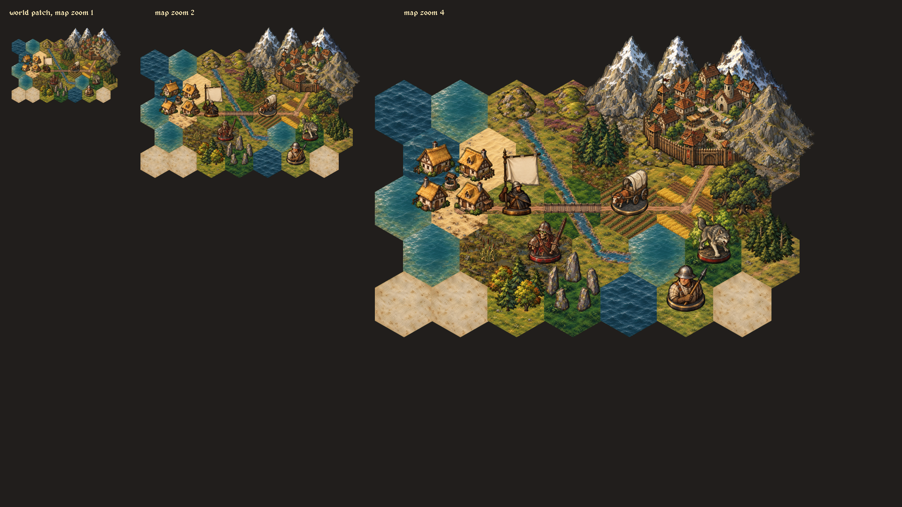
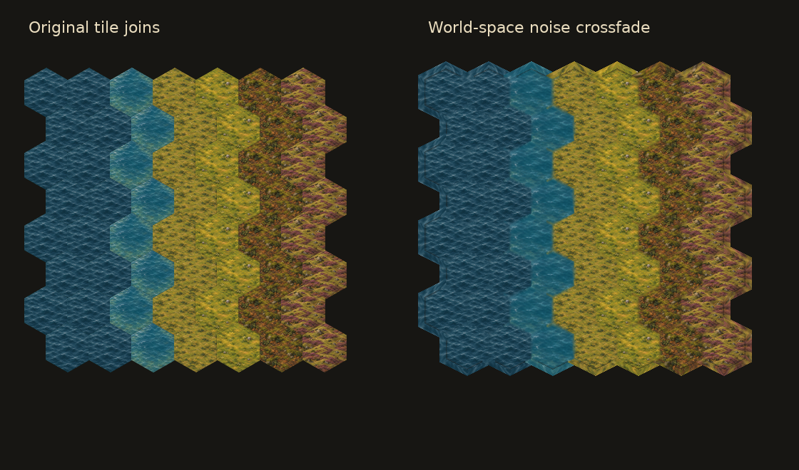

# The overworld's soft tile joins

These shaders are written for LÖVE's GLSL dialect (`Image`, `Texel`, and `effect`). They are verbatim extractions from the original [shader module](../reference/rendering/map/shaders.lua). Port their sampling and uniforms if using another engine.

## Fringe shader

[fringe.glsl](../shaders/fringe.glsl) makes a hex's transition look broken by brushwork. It does four jobs:

1. Draw the tile on a quad enlarged by 1.36×, giving the transition room beyond the painted hex.
2. Mirror texture samples inward past the painted edge, providing terrain colour wherever the transition reaches. Correct for the texture's premultiplied alpha before changing its coverage.
3. Measure coverage against the same cell region that picking uses. The cell's own ground stays the greater share inside its region, and fades to half strength at its boundary.
4. Vary the transition's width with two scales of value noise sampled in world coordinates. This keeps the broken edge fixed while the camera moves and agrees across bake chunks.

The ground is drawn in two passes, each in terrain-priority order:

- `layer = 1` (**UNDER**): opaque bands just outside each cell provide backing for neighbours' fades.
- `layer = 2` (**GROUND**): the cell interior fades toward half strength on its edge.

`layer = 0` (**OVERLAY**) is used for parchment fog: keep the region opaque and fade outward. It is not the two-pass ground blend.

### Uniforms and integration

| Uniform | Meaning |
| --- | --- |
| `size`, `centre` | Texture canvas and hex centre, in source pixels |
| `hex` | Painted half-width, half-height and slanted-tip height, in source pixels |
| `region`, `slope` | Actual picking-region extents, including row-parity differences |
| `source_scale`, `row_pitch` | Source pixels per world unit; row spacing in world units |
| `quad` | Enlarged draw quad, 1.36 in the original |
| `fringe` | Noise-modulated reach, 0.42 in the original |
| `layer` | OVERLAY 0, UNDER 1, GROUND 2 |
| `inset` | Fraction of the painted texture sampled; shallow water uses a smaller interior crop |
| `noise_origin`, `noise_scale` | Convert render-target pixels into the same world coordinates in every chunk |

For exact setup and drawing, read `setup_fringe`, `fringed_box` and `draw_fringed` in the [shader module](../reference/rendering/map/shaders.lua), then `draw_ground` and `draw_world` in [canvas.lua](../reference/rendering/map/canvas.lua). Geometry is in [hex/grid.lua](../hex/grid.lua); original paint settings are in the [manifest](../reference/data/world/tiles/manifest.lua).

The complete game bakes the map into mipmapped chunks with neighbour gutters, then draws the canvases with premultiplied-alpha blending. Those gutters prevent filtering seams at chunk boundaries. The reference modules retain their game imports; this repository does not ship the game state or all runtime dependencies.

The image below is an original art-production composition showing tile, strip and object layering at three zooms. It predates the runtime blending pass and shows the unblended tile joins; it is not evidence of the fringe shader's output.

## Native shader comparison

The same exported ground images drawn directly (left) and through the original two-pass shader (right). This small native LÖVE capture uses the exported shader and shared geometry; it is a technique patch, not a complete world simulation. Both extracted shaders compiled successfully during the check.

## Sight shader

[sight.glsl](../shaders/sight.glsl) gradually desaturates and darkens explored ground outside the company's current sight circle. It takes the circle centre, radius and soft edge in render-target pixels, plus grey and dim strengths. This is separate from unexplored parchment fog and from terrain blending.

## Why the battlefield uses a different join

Battlefield caps already have an alpha fringe baked into their PNGs, and raised surfaces must occlude units cleanly. The battle renderer therefore blends floor caps as images and clips depth-sorted scene pieces to meshes. The overworld is a flatter composition and uses the noise-broken shader to crossfade its ground.
