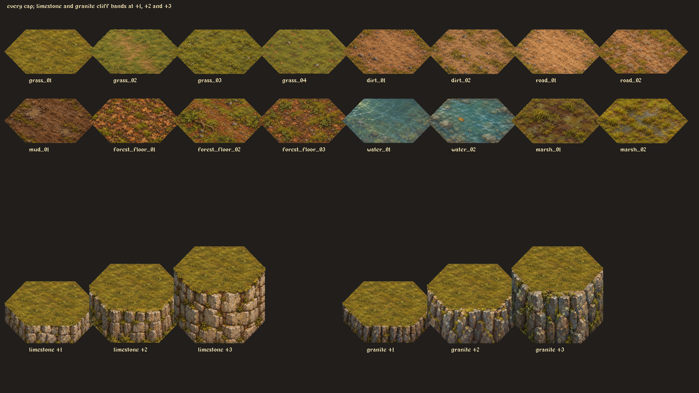
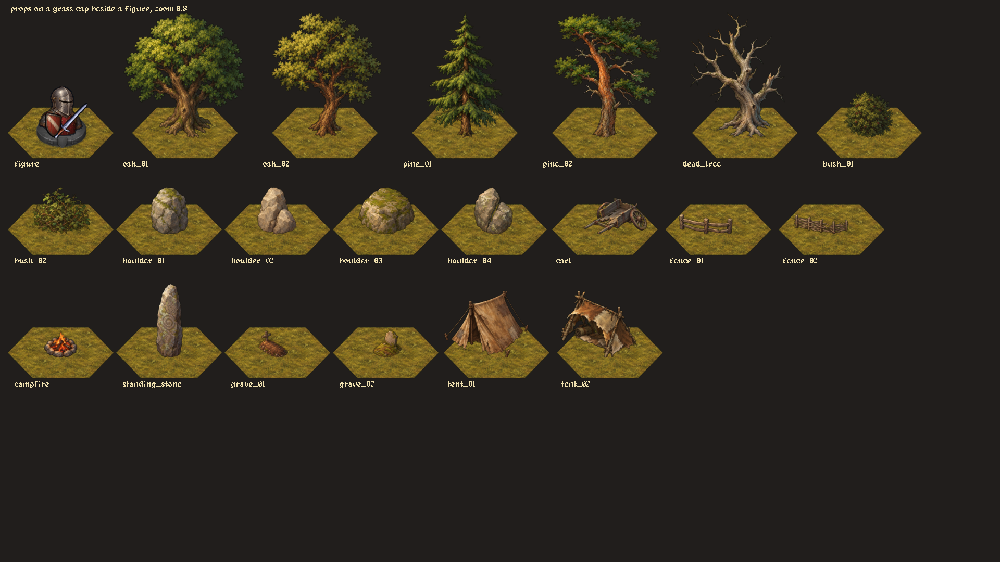

# From paintings to a battlefield

The visual consistency comes from a shared contract, followed by inspection in context. A prompt alone cannot guarantee a matching set.

## 1. Let the game geometry define the art

The battlefield uses a flattened hex seen from a high three-quarter viewpoint. `hex/geometry.lua` defines its polygon and grid spacing. The tool derives the guide from that polygon, so the artist and renderer use the same shape.

The five exported families in `data/items/visual_templates.lua` are:

| Family | Scale: export pixels per game pixel | Placement rule |
| --- | --- | --- |
| `hex_cap` | 2 | Fit the top-face polygon; anchor it to the ground surface |
| `cliff_band` | 2 | Fit the front face for one, two or three elevation steps |
| `prop` | 2 | Fit a size class by painted height; place the base on the surface |
| `world_tile` | 4 | Fit the overworld ground hex, half-edge strip or road hub |
| `doodad` | 4 | Fit a forest, hill, peak or reeds by height; anchor its base |

These are different grids. Battlefield art is not interchangeable with the pointy-top overworld tiles.

## 2. Give every piece the same art direction

Use crops of one approved mockup as style references. Ground, cliff and prop families use different crops of the same battlefield mockup. Prompts ask for a shared viewpoint, muted natural colours and upper-left lighting.

Ground stays low in contrast and fairly even in value, so neighbouring caps blend and characters stay readable. Trees and rocks can carry stronger light and shadow. Ground prompts exclude props, cliff sides and figures. Prop prompts exclude a ground patch and cast shadow. Separating these layers lets the game recombine them.

Example subjects are in the curated [battlefield batch](../tools/art/batches/battlefield.lua). The exact full prompts that produced the shipped images are in [the asset index](assets.md), including the successful retry selected for each piece. Original attempts are recorded in the adjacent JSON; public batches begin a new attempt sequence.

## 3. Remove the matte without a green halo

The paintings were requested on perfectly flat `#00FF00`, with no pure chroma green inside the subject. The normalizer measures green excess:

```text
excess = green - max(red, blue)
```

Strong excess removes the background. Intermediate excess reduces alpha and removes green spill from the edge. It is not a blanket deletion of every green pixel: olive grass must survive. The implementation and thresholds are in `key_matte` in [fit.lua](../tools/art/fit.lua).

The pipeline also removes isolated specks and haze. Its resampler takes colour from solid samples, avoiding contamination from the matte. A halo check measures suspiciously bright soft-edge pixels. Check the result against both light and dark grounds; chroma keying is an approximation and some generations need another attempt.

## 4. Fit with one scale and a translation

For caps and cliffs, `fits.silhouette` searches for the uniform scale and x/y translation that maximize intersection-over-union with the target silhouette. It uses a coarse search followed by refinement. It does not independently stretch width and height.

For props, `fits.footprint` scales the painted height to the size class. It estimates the contact point from the bottom part of the subject, then aligns that with the template's `base` landmark. An oak trunk and a boulder therefore land on the same ground coordinate even when their source canvases have different margins.

## 5. Seal the gaps, then feather

Battlefield caps fit to the hex polygon expanded by **8 export pixels**. Outside that expanded polygon, their alpha fades to zero over another **16 export pixels**. At 2× scale those distances are 4 and 8 game pixels.

```text
inside expanded polygon: keep alpha
outside: alpha *= max(0, 1 - distance_to_polygon / fringe)
```

The slight overlap closes the spaces between the game's caps. The transparent fringe blends adjacent paintings when the floor is drawn. Several variants of grass, soil and forest floor make repetition less obvious.



## 6. Make elevation and occlusion explicit

The battlefield has two terrain passes. Ground-level caps draw below the scene, with their soft fringes. Raised caps, cliff faces and water pieces that must hide something draw in the depth-sorted scene.

Those scene pieces use meshes clipped to their hex; their fringes cannot spill over a character or tactical mark. Water has a rear surface below a wader and a near piece that covers the legs. Cliff bands represent one, two or three elevation steps, below their matching top cap.

Study the comments and mesh construction in [terrain_renderer.lua](../reference/rendering/terrain_renderer.lua), and the bands and sorting in [battle_drawlists.lua](../reference/rendering/battle_drawlists.lua). These are full game source modules for reference, not standalone renderers.



## 7. Inspect at the size players see

The original production loop was guide → generation → normalize → contact sheet → native game capture → review → promotion. Failed fill, clipping, halo or lighting checks require another attempt or a corrected template. Passing those checks is necessary but cannot prove that two paintings look right together.

Load the painted art with linear filtering and mipmaps when it minifies. Place trees, rocks and figures together at the game's usual zoom. Judge relative scale, palette and contact points there, rather than judging isolated full-resolution PNGs.

The [overworld](shaders.md) adds a runtime shader for more irregular transitions; the battlefield's cap joins use the precomputed alpha fringe described above.
